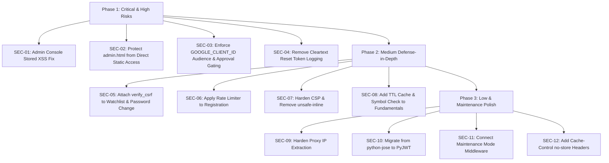

# StockPro Analytics Dashboard — Security Audit Report

**Assessment Type:** Source Code Security Audit & Defensive Architecture Review  
**Repository:** `StockPro`  
**Target Environment:** FastAPI + MySQL + Static HTML/CSS/JavaScript Frontend  
**Mode:** Strictly Read-Only Audit  
**Date of Audit:** October 10, 2026  

---

## A. Executive Summary

A comprehensive security audit of the **StockPro Analytics Dashboard** was conducted across backend application logic, database access layers, authentication and authorization flows, API design, dependency manifests, configuration settings, and static frontend assets.

### Key Takeaways
1. **Strong Core Hardening Baseline:** StockPro possesses substantial defense-in-depth measures compared to standard financial dashboards. Parameterized SQL queries are consistently utilized via `%s` tuples in MySQL connector calls; database exception details are sanitized at the API boundary; and strict server-side Role-Based Access Control (RBAC) safeguards exist to protect privileged administrative actions (such as canonical stock data ingestion, user lifecycle management, and session revocation).
2. **Critical Vulnerabilities Requiring Attention:**
   - **Stored Cross-Site Scripting (XSS) in the Admin Operations Console:** User-supplied registration fields (`name`, `email`) are rendered via unescaped string interpolation into `innerHTML` within `static/admin.html` (lines 2475–2485). Combined with a Content Security Policy that permits `'unsafe-inline'`, this allows an unauthenticated applicant to execute arbitrary JavaScript within an administrator's active session, enabling full administrative takeover.
   - **Static File RBAC Bypass on the Admin Portal Template:** While clean URL routes like `/admin` and `/admin/users` enforce server-side authentication redirects, `app.py` (line 200) mounts the entire `static/` directory directly at `/`. Consequently, unauthenticated visitors can fetch `/admin.html` directly, exposing administrative markup, form IDs, and client-side logic.
   - **Insecure Google OAuth Audience Verification:** In `routers/auth.py` (lines 307–316), if `GOOGLE_CLIENT_ID` is unconfigured or empty, `audience=None` is passed to Google's token verification library. This causes Google's library to skip validating the `aud` claim, accepting ID tokens issued for *any* application. Furthermore, Google authentication automatically provisions accounts with `approval_status='approved'`, completely bypassing the admin approval workflow.
   - **Cleartext Password Reset Secret Logging:** In `routers/auth.py` (lines 526–527), generated single-use password reset tokens are logged to application logs at `INFO` level, allowing anyone with access to server logs or terminal output to hijack user accounts.
3. **Data Isolation & IDOR Status:** Private user data (watchlists, saved scans, price alerts, and dashboard widgets) enforces tenant ownership checks (`WHERE user_id = %s`). No horizontal privilege escalation (IDOR/BOLA) was identified across user-isolated assets.

---

## B. Findings

---

### Finding SEC-01: Stored Cross-Site Scripting (XSS) in Admin Operations Console
- **Severity:** **Critical**
- **Confidence:** **Confirmed**
- **File & Line:** `static/admin.html:2475-2485`, `static/admin.html:2465-2470`, `static/admin.html:2906-2908`
- **Relevant Code Evidence:**
  ```javascript
  // static/admin.html (lines 2475-2480)
  tr.innerHTML = `
    <td style="font-family:'JetBrains Mono',monospace;">#${u.id}</td>
    <td>
      <div style="font-weight:600;">${u.name} ${isMe ? '<span class="badge badge-primary">You</span>' : ''}</div>
      <div style="font-size:0.78rem; color:var(--text-muted);">${u.email}</div>
    </td>
  ...
  <button onclick="promptRevokeSessions(${u.id}, '${u.email}')">
  <button onclick="promptDeleteUser(${u.id}, '${u.email}')">
  ```
  ```javascript
  // static/admin.html (lines 2906-2908)
  <td style="font-family:'JetBrains Mono',monospace; font-size:0.75rem;">
    ${JSON.stringify(l.details)}
  </td>
  ```
- **Vulnerability Explanation:**  
  When an applicant self-registers via `POST /api/auth/register`, `RegisterRequest` in `routers/auth.py` only validates that `name` is non-empty and under 128 characters. No HTML sanitization occurs. The server stores this name in `users.name`. When an administrator opens the StockPro Admin Console (`/admin` -> `/admin/users`), `fetch('/api/admin/users')` retrieves the user list, and `renderUsersTable()` concatenates `${u.name}` and `${u.email}` directly into template literals passed to `tr.innerHTML`. Furthermore, `JSON.stringify(l.details)` in `loadAuditLogs()` does not escape HTML entities (`<`, `>`).
- **Realistic Attack Scenario & Impact:**  
  1. An attacker registers an account with `name`: ``.
  2. The administrator navigates to the Admin Console to review pending approvals.
  3. The browser evaluates `tr.innerHTML`, triggering the `onerror` payload under the administrator's origin.
  4. Because the browser's Content Security Policy allows `'unsafe-inline'` (`app.py:45`), the script executes unhindered, reads the non-httpOnly `csrf_token` cookie, and submits a privileged role upgrade or creates a new administrator account.
  5. **Impact:** Complete compromise of application state, administrative data exfiltration, and full privilege escalation.
- **Minimal Recommended Fix:**  
  Introduce an HTML-escaping utility in `static/admin.html` and sanitize all dynamic values before inserting into `innerHTML`, or construct DOM nodes using `textContent`:
  ```javascript
  function escapeHtml(str) {
    if (!str) return '';
    return String(str).replace(/[&<>"']/g, m => ({
      '&': '&amp;', '<': '&lt;', '>': '&gt;', '"': '&quot;', "'": '&#39;'
    }[m]));
  }
  ```
  Replace `${u.name}` with `${escapeHtml(u.name)}`, `${u.email}` with `${escapeHtml(u.email)}`, and `${JSON.stringify(l.details)}` with `${escapeHtml(JSON.stringify(l.details))}`. In event listeners, pass only integer IDs (e.g. `onclick="promptDeleteUser(${u.id})"`) and look up the email in memory rather than interpolating strings into JavaScript attributes.
- **Appropriate Regression Test:**  
  Create an integration test in `test_security.py` that registers a user with `<script>alert(1)</script>` and verifies that calling `/api/admin/users` returns data that is either HTML-encoded by the API or properly escaped in frontend unit tests without script evaluation.

---

### Finding SEC-02: Direct Static Access Bypass to Admin Console Template (`/admin.html`)
- **Severity:** **High**
- **Confidence:** **Confirmed**
- **File & Line:** `app.py:200`, `routers/admin.py:26-49`
- **Relevant Code Evidence:**
  ```python
  # app.py (line 200)
  app.mount("/", StaticFiles(directory="static", html=True), name="static")
  ```
  ```python
  # routers/admin.py (lines 70-72)
  @router.get("/admin", include_in_schema=False)
  def serve_admin_overview(request: Request, current_user: dict = Depends(require_admin_page)):
      return FileResponse("static/admin.html")
  ```
- **Vulnerability Explanation:**  
  `routers/admin.py` implements a server-side dependency `require_admin_page` for `/admin`, `/admin/users`, `/admin/security`, etc., issuing a 302 redirect to `/login` if no valid admin session is present. However, because `static/` is mounted at `"/"` with `html=True` as a fallback static handler in `app.py` (line 200), any unauthenticated HTTP client can issue `GET /admin.html`. The static file handler serves the complete HTML document directly, bypassing `require_admin_page`.
- **Realistic Attack Scenario & Impact:**  
  An unauthenticated attacker requests `https://app.stockpro.com/admin.html`. While subsequent `/api/admin/*` data fetches will return 401/403, the client-side templates, administrative forms, hidden features, endpoint structures, telemetry metrics names, and internal logic are fully disclosed.
- **Minimal Recommended Fix:**  
  Move `admin.html` out of the public `static/` directory into a dedicated `templates/` or `private_static/` folder that is *not* mounted by `StaticFiles`. Ensure `FileResponse("templates/admin.html")` is only returned by routes protected by `require_admin_page`. Alternatively, add an explicit route in `app.py`:
  ```python
  @app.get("/admin.html", include_in_schema=False)
  def redirect_admin_html():
      return RedirectResponse(url="/admin", status_code=301)
  ```
- **Appropriate Regression Test:**  
  Add a test in `test_security.py` that makes an unauthenticated `GET /admin.html` request and verifies it returns a 302/301 redirect or 403 Forbidden, rather than a 200 OK serving the admin dashboard HTML.

---

### Finding SEC-03: Insecure Google OAuth Audience Validation & Admin Approval Bypass
- **Severity:** **High**
- **Confidence:** **Confirmed**
- **File & Line:** `routers/auth.py:307-316`, `routers/auth.py:341-348`, `config.py:44-67`
- **Relevant Code Evidence:**
  ```python
  # routers/auth.py (lines 307-316)
  client_id = os.getenv("GOOGLE_CLIENT_ID", "").strip()
  req = google_requests.Request()
  audience = client_id if client_id else None
  id_info = id_token.verify_oauth2_token(
      body.credential,
      req,
      audience=audience,
      clock_skew_in_seconds=60
  )
  ```
  ```python
  # routers/auth.py (lines 341-348)
  if user is None:
      # Auto-register new Google verified user with 365-day validity
      cursor.execute(
          """
          INSERT INTO users (email, name, role, google_id, auth_provider, is_active, approval_status, expires_at)
          VALUES (%s, %s, 'user', %s, 'google', 1, 'approved', DATE_ADD(NOW(), INTERVAL 365 DAY))
          """,
          (email, name, google_id),
      )
  ```
- **Vulnerability Explanation:**  
  1. **Audience Omission:** In `routers/auth.py`, if `GOOGLE_CLIENT_ID` is empty or unconfigured, `audience` evaluates to `None`. In Google's `verify_oauth2_token()`, passing `audience=None` skips audience verification. Any valid Google ID token minted for *any* application on the internet will be accepted as authentic.
  2. **Approval Workflow Bypass:** Standard registration via `POST /api/auth/register` creates accounts with `is_active=0` and `approval_status='pending'`, requiring explicit admin approval. In contrast, `POST /api/auth/google` automatically activates accounts with `approval_status='approved'` and `is_active=1`.
  3. **Account Pre-Hijacking:** If an existing local user has registered with an email, a Google user with matching email can immediately sign into that account without proof that the original account owner authorized Google linking.
- **Realistic Attack Scenario & Impact:**  
  If `GOOGLE_CLIENT_ID` is missing from the environment, an attacker generates a legitimate Google ID token using their own client credentials (e.g. from their own Google Cloud project) for any target email address. They submit this token to `POST /api/auth/google`. The server accepts the token, bypasses the approval queue, and authenticates the attacker as an active user or hijacks an existing account.
- **Minimal Recommended Fix:**  
  1. Require `GOOGLE_CLIENT_ID` to be explicitly set before enabling Google authentication. If unset, return `503 Service Unavailable`:
     ```python
     if not client_id:
         raise HTTPException(status_code=503, detail="Google authentication is not configured.")
     id_info = id_token.verify_oauth2_token(body.credential, req, audience=client_id, clock_skew_in_seconds=60)
     ```
  2. Maintain consistent approval policy: if user approval is required, set `approval_status='pending'` and `is_active=0` for new Google signups as well.
  3. Add `GOOGLE_CLIENT_ID` validation to `validate_security_config()` in `config.py`.
- **Appropriate Regression Test:**  
  Add a test in `test_security.py` ensuring that `POST /api/auth/google` with `GOOGLE_CLIENT_ID=""` rejects the request with HTTP 503 rather than calling `verify_oauth2_token(..., audience=None)`.

---

### Finding SEC-04: Cleartext Password Reset Token Logged to Application Logs
- **Severity:** **High**
- **Confidence:** **Confirmed**
- **File & Line:** `routers/auth.py:526-527`
- **Relevant Code Evidence:**
  ```python
  # routers/auth.py (lines 526-527)
  logger.info("SECURITY_EVENT: PASSWORD_RESET_REQUESTED email=%s, ip=%s", body.email.lower(), ip)
  logger.info("PASSWORD_RESET_LINK: /reset-password.html?token=%s (for email=%s)", reset_token, body.email.lower())
  ```
- **Vulnerability Explanation:**  
  When a user triggers `/api/auth/forgot-password`, a signed JWT reset token is created with a 30-minute validity window. Line 527 writes the complete URL containing the cleartext token to the logger at `INFO` level. In production, log files, terminal streams, and centralized log collectors (e.g. Datadog, CloudWatch, ELK) will capture this secret.
- **Realistic Attack Scenario & Impact:**  
  An attacker triggers a password reset for a known target email (e.g. an admin account). Anyone with read permissions on log files, access to developer consoles, or a monitoring dashboard reads the `PASSWORD_RESET_LINK` line, extracts `reset_token`, visits `/reset-password.html?token=...`, and resets the password, gaining complete account takeover.
- **Minimal Recommended Fix:**  
  Remove the token from logging. Log only that an email was dispatched:
  ```python
  logger.info("SECURITY_EVENT: PASSWORD_RESET_REQUESTED email=%s, ip=%s", body.email.lower(), ip)
  ```
- **Appropriate Regression Test:**  
  Add a unit test in `test_security.py` using `unittest.mock.patch('routers.auth.logger.info')` to verify that when `/api/auth/forgot-password` is called, no log message contains the word `token=` or the generated JWT string.

---

### Finding SEC-05: Missing CSRF Verification on Watchlist and Password Change Mutations
- **Severity:** **Medium**
- **Confidence:** **Confirmed**
- **File & Line:** `routers/watchlist.py:136-166`, `routers/watchlist.py:169-180`, `routers/auth.py:638-644`
- **Relevant Code Evidence:**
  ```python
  # routers/watchlist.py (lines 136-137)
  @router.post("")
  def add_to_watchlist(body: WatchlistAddRequest, current_user: dict = Depends(get_current_user)):
  ```
  ```python
  # routers/watchlist.py (lines 169-170)
  @router.delete("/{symbol}")
  def remove_from_watchlist(symbol: str, current_user: dict = Depends(get_current_user)):
  ```
  ```python
  # routers/auth.py (lines 638-639)
  @router.post("/change-password")
  def change_password(body: ChangePasswordRequest, request: Request, current_user: dict = Depends(get_current_user)):
  ```
- **Vulnerability Explanation:**  
  Double-submit CSRF protection (`x-csrf-token`) was asserted to cover all state-changing endpoints (`POST`, `PUT`, `DELETE`, `PATCH`). While `routers/admin.py`, `routers/alerts.py`, and `routers/scans.py` consistently inject `dependencies=[Depends(verify_csrf)]` or `_: None = Depends(verify_csrf)`, `routers/watchlist.py` (`POST ""` and `DELETE "/{symbol}"`) and `routers/auth.py` (`POST "/change-password"`) completely omit the `verify_csrf` dependency.
- **Realistic Attack Scenario & Impact:**  
  Although `SameSite=Lax` on auth cookies mitigates basic cross-origin POSTs in standard modern browsers, defense-in-depth is violated. If an attacker discovers a cross-site scripting flaw on a related subdomain or uses browser quirks, they can execute state changes (such as modifying watchlists or attempting brute-forced password changes) without supplying a valid CSRF token.
- **Minimal Recommended Fix:**  
  Import `verify_csrf` and attach it as a dependency:
  ```python
  # In routers/watchlist.py:
  from auth import get_current_user, verify_csrf
  @router.post("", dependencies=[Depends(verify_csrf)])
  def add_to_watchlist(...):
  @router.delete("/{symbol}", dependencies=[Depends(verify_csrf)])
  def remove_from_watchlist(...):

  # In routers/auth.py:
  @router.post("/change-password", dependencies=[Depends(verify_csrf)])
  def change_password(...):
  ```
- **Appropriate Regression Test:**  
  Add tests in `test_security.py` calling `POST /api/watchlist` and `POST /api/auth/change-password` with valid session cookies but omitting `x-csrf-token`, asserting an HTTP 403 Forbidden response.

---

### Finding SEC-06: Lack of Rate Limiting on User Registration & Google Authentication
- **Severity:** **Medium**
- **Confidence:** **Confirmed**
- **File & Line:** `routers/auth.py:130-135`, `routers/auth.py:291-300`
- **Relevant Code Evidence:**
  ```python
  # routers/auth.py (line 130)
  @router.post("/register", status_code=status.HTTP_201_CREATED)
  def register(body: RegisterRequest, request: Request):
      ip = get_client_ip(request)
      hashed = hash_password(body.password)
      # [No login_rate_limiter.check_and_record call]
  ```
- **Vulnerability Explanation:**  
  While `/login` and `/forgot-password` enforce sliding-window rate limiting via `login_rate_limiter.check_and_record()`, `/api/auth/register` and `/api/auth/google` do not enforce any rate limit checks. Furthermore, every registration executes five database inserts seeding default strategy scans.
- **Realistic Attack Scenario & Impact:**  
  An attacker can write a simple loop submitting thousands of registrations per minute. Each request runs a CPU-intensive bcrypt hash (`hash_password`), executes database transactions, and inflates the `users` and `saved_scans` tables, causing server CPU exhaustion, database bloat, and admin approval queue denial of service.
- **Minimal Recommended Fix:**  
  Enforce rate limiting on `/register` and `/google`:
  ```python
  login_rate_limiter.check_and_record(request)
  ```
- **Appropriate Regression Test:**  
  Add a test in `test_security.py` sending 6 rapid registration requests from the same IP address and asserting that the 6th request receives HTTP 429 Too Many Requests.

---

### Finding SEC-07: Content Security Policy Allows `'unsafe-inline'` Scripts and Styles
- **Severity:** **Medium**
- **Confidence:** **Confirmed**
- **File & Line:** `app.py:44-53`
- **Relevant Code Evidence:**
  ```python
  # app.py (lines 44-53)
  csp = (
      "default-src 'self'; "
      "script-src 'self' 'unsafe-inline' https://cdn.jsdelivr.net https://cdnjs.cloudflare.com https://accounts.google.com/gsi/client; "
      "style-src 'self' 'unsafe-inline' https://fonts.googleapis.com https://cdnjs.cloudflare.com https://accounts.google.com/gsi/style; "
      "font-src 'self' https://fonts.gstatic.com https://cdnjs.cloudflare.com data:; "
      "img-src 'self' data: https: https://*.googleusercontent.com; "
      "frame-src 'self' https://accounts.google.com/gsi/; "
      "connect-src 'self' https://accounts.google.com/gsi/; "
      "frame-ancestors 'self';"
  )
  ```
- **Vulnerability Explanation:**  
  The Content Security Policy (CSP) headers emitted by `SecurityHeadersMiddleware` specify `'unsafe-inline'` for `script-src`. This negates the browser's primary built-in protection against Cross-Site Scripting, enabling any injected script or inline DOM event handler (`onerror`, `<script>`) to execute.
- **Realistic Attack Scenario & Impact:**  
  As detailed in Finding SEC-01, an attacker injects an HTML tag with inline JavaScript attributes into user profile data. Because CSP allows `'unsafe-inline'`, the browser executes the payload without restriction.
- **Minimal Recommended Fix:**  
  Migrate inline `<script>` blocks in `index.html` and `admin.html` into static script files (e.g. `static/js/`), or introduce cryptographic nonces (`'nonce-{random}'`) generated per request and injected into CSP headers and script tags.
- **Appropriate Regression Test:**  
  Add a test verifying that `Strict-Transport-Security` and CSP headers are emitted and that `script-src` does not contain `'unsafe-eval'`.

---

### Finding SEC-08: Unbounded Synchronous Third-Party Outbound Requests in Fundamentals API
- **Severity:** **Medium**
- **Confidence:** **Confirmed**
- **File & Line:** `routers/fundamentals.py:139-198`, `routers/fundamentals.py:282-314`
- **Relevant Code Evidence:**
  ```python
  # routers/fundamentals.py (lines 190-192)
  stock = yf.Ticker(ticker)
  raw = getattr(stock, attr)
  ```
  ```python
  # routers/fundamentals.py (lines 289-293)
  ticker = yf.Ticker("USDINR=X")
  info = ticker.fast_info
  inr_per_usd = float(info.last_price)
  ```
- **Vulnerability Explanation:**  
  Endpoints `GET /api/fundamentals` and `GET /api/usd-rate` are publicly accessible without authentication. Every incoming request synchronously contacts external Yahoo Finance endpoints via `yfinance.Ticker()`. There is no caching on financial statements, no timeout boundary, and no IP rate limiter.
- **Realistic Attack Scenario & Impact:**  
  A remote attacker sends concurrent requests with random ticker names. The server's synchronous thread pool becomes blocked waiting on Yahoo Finance HTTP responses, causing thread pool starvation, denial of service for regular users, and potential IP blacklisting of the application server by Yahoo Finance.
- **Minimal Recommended Fix:**  
  1. Add in-memory TTL caching (e.g. via `cache.py` or `functools.lru_cache`) with a TTL of 1–6 hours for fundamental statements and 15 minutes for USD/INR exchange rate.
  2. Implement an input allowlist for `ticker` restricting requests to valid NSE/BSE symbols (e.g. validating against `SYMBOLS` from `symbols_list.py`).
  3. Enforce rate limiting on `/api/fundamentals`.
- **Appropriate Regression Test:**  
  Verify that two consecutive requests to `/api/fundamentals?ticker=RELIANCE.NS&statement=balance_sheet` return the identical cached payload without invoking upstream network calls twice.

---

### Finding SEC-09: Client IP Spoofing via `X-Forwarded-For` when `BEHIND_TRUSTED_PROXY=true`
- **Severity:** **Low**
- **Confidence:** **Probable**
- **File & Line:** `rate_limiter.py:98-115`
- **Relevant Code Evidence:**
  ```python
  # rate_limiter.py (lines 103-107)
  if BEHIND_TRUSTED_PROXY:
      forwarded = request.headers.get("X-Forwarded-For")
      if forwarded:
          # First IP in comma-separated list is the original client
          return forwarded.split(",")[0].strip()
  ```
- **Vulnerability Explanation:**  
  When `BEHIND_TRUSTED_PROXY` is enabled, the code extracts the leftmost IP from `X-Forwarded-For` without validating that the intermediate proxy hops belong to a trusted IP CIDR range. If an upstream proxy or CDN appends rather than overwrites incoming headers, an attacker can supply `X-Forwarded-For: 1.2.3.4`, rotating the spoofed IP on each request.
- **Realistic Attack Scenario & Impact:**  
  An attacker mounts a credential stuffing attack on `/api/auth/login`. By supplying a different random `X-Forwarded-For` header with each attempt, the IP-level rate limiter (`ratelimit:ip:...`) fails to throttle the attacker. Note that the account-level rate limiter (`ratelimit:account:...`) still triggers, limiting the blast radius to distributed multi-account attacks.
- **Minimal Recommended Fix:**  
  Validate that requests originate from a known trusted proxy upstream before reading `X-Forwarded-For`, or take the IP added by the trusted ingress edge (rightmost untrusted IP).
- **Appropriate Regression Test:**  
  Test `get_client_ip()` with simulated proxy headers to verify trusted upstream validation behavior.

---

### Finding SEC-10: Outdated & Unmaintained Dependency `python-jose` with Public Advisories
- **Severity:** **Low**
- **Confidence:** **Confirmed**
- **File & Line:** `requirements.txt:6`
- **Relevant Code Evidence:**
  ```text
  python-jose[cryptography]==3.3.0
  ```
- **Vulnerability Explanation:**  
  `python-jose` has been unmaintained since 2021 and has active security advisories:
  - **CVE-2024-33663:** Algorithm confusion vulnerabilities where tokens may be improperly parsed.
  - **CVE-2024-33664:** Denial-of-service / resource exhaustion via quadratic complexity on JWE decryption.
  While StockPro uses standard HMAC-SHA256 (`HS256`) with explicit `algorithms=[JWT_ALGORITHM]` in `auth.py:59`, maintaining obsolete cryptographic dependencies presents long-term supply-chain risk.
- **Realistic Attack Scenario & Impact:**  
  Future Python interpreter upgrades or edge-case malformed token payloads could trigger unexpected exceptions, memory exhaustion, or security edge cases.
- **Minimal Recommended Fix:**  
  Migrate from `python-jose` to the actively maintained `PyJWT` library (`pip install PyJWT>=2.8.0`).
- **Appropriate Regression Test:**  
  Run all JWT generation and validation unit tests in `test_security.py` after replacing `jose.jwt` with `jwt`.

---

### Finding SEC-11: Maintenance Mode Configuration Ineffective in Runtime
- **Severity:** **Informational**
- **Confidence:** **Confirmed**
- **File & Line:** `admin_service.py:1051-1067`, `app.py`
- **Relevant Code Evidence:**
  ```python
  # admin_service.py (line 1051)
  def is_maintenance_mode_active() -> bool:
      ...
  ```
- **Vulnerability Explanation:**  
  The Admin Operations Console allows administrators to toggle `maintenance_mode` on or off. While `is_maintenance_mode_active()` is defined in `admin_service.py`, grep inspection reveals that this function is *never invoked* by any middleware or router in `app.py`.
- **Realistic Attack Scenario & Impact:**  
  An administrator activates Maintenance Mode prior to performing database maintenance, believing user access is disabled. However, all user-facing endpoints continue accepting traffic and executing database queries uninterrupted.
- **Minimal Recommended Fix:**  
  Add a lightweight middleware in `app.py` that checks `is_maintenance_mode_active()` and returns a `503 Service Unavailable` page for non-admin requests when active:
  ```python
  @app.middleware("http")
  async def maintenance_middleware(request: Request, call_next):
      if not request.url.path.startswith(("/admin", "/api/admin", "/static", "/favicon.ico")):
          if is_maintenance_mode_active():
              return JSONResponse(status_code=503, content={"detail": "StockPro is temporarily offline for scheduled maintenance."})
      return await call_next(request)
  ```
- **Appropriate Regression Test:**  
  Add a test verifying that when `maintenance_mode` is `'true'`, requests to `/api/data` return 503 while requests to `/api/admin/overview` remain accessible to administrators.

---

### Finding SEC-12: Missing `Cache-Control: no-store` on Private Authenticated Responses
- **Severity:** **Informational**
- **Confidence:** **Confirmed**
- **File & Line:** `app.py:29-55`
- **Relevant Code Evidence:**
  `SecurityHeadersMiddleware` sets `X-Content-Type-Options`, `X-Frame-Options`, `Referrer-Policy`, `Permissions-Policy`, and `Content-Security-Policy`, but does not set `Cache-Control` on authenticated endpoints.
- **Vulnerability Explanation:**  
  Endpoints returning private user or administrative information (such as `/api/auth/me`, `/api/watchlist`, `/api/alerts`, and `/api/admin/*`) do not explicitly emit `Cache-Control: no-store, no-cache, private`.
- **Realistic Attack Scenario & Impact:**  
  On shared or public computers, a user logs out, but the browser back button displays cached responses containing private portfolio or watchlist information stored in disk or memory cache.
- **Minimal Recommended Fix:**  
  In `SecurityHeadersMiddleware`, check if the response is from an authenticated API path or contains sensitive headers, and apply `Cache-Control: no-store, no-cache, must-revalidate, private`.
- **Appropriate Regression Test:**  
  Assert that responses from `/api/auth/me` include `Cache-Control: no-store`.

---

## C. Coverage

| Area / Component | Files Inspected | Checks Performed | Status |
| :--- | :--- | :--- | :--- |
| **Secrets & Keys** | `config.py`, `.env.example`, `.gitignore`, Git history | Inspected git commits, `.gitignore`, credential fallbacks, database credentials, OpenRouter key, and JWT generation logic. | **Verified Clean** (Git history contains no committed `.env`; production gating enforces high-entropy secrets and rejects default `root/root`). |
| **Authentication** | `auth.py`, `routers/auth.py` | Password hashing (bcrypt), token expiration, token version session revocation, password reset flow, and Google OAuth ID token verification. | **4 Findings** (Google OAuth audience omission, password reset token logged, missing register rate limit). |
| **Authorization & RBAC** | `auth.py`, `routers/admin.py`, `admin_service.py` | Role enforcement (`require_admin`), user status checks (`is_active`), approval workflow (`approval_status`), validity countdown (`expires_at`), self-demotion and self-deletion safeguards. | **1 Finding** (`static/admin.html` direct access bypass). |
| **Tenant Isolation (IDOR)** | `routers/watchlist.py`, `routers/alerts.py`, `routers/scans.py`, `routers/dashboard.py` | Examined all route paths and SQL queries for tenant isolation (`user_id = %s`), widget ownership, scan modification rights, alert ownership. | **Verified Clean** (Strict tenant isolation maintained across all user models). |
| **SQL Injection** | `database.py`, `scan_engine.py`, `services.py`, `routers/*.py` | Inspected every dynamic SQL construction, f-strings, `cursor.execute()` calls, table join queries, and allowlisted column names. | **Verified Clean** (All dynamic filters utilize strict allowlists; parameters passed as sanitized tuples). |
| **Frontend & XSS** | `static/admin.html`, `static/index.html`, `static/js/ui-core.js` | Analyzed `innerHTML`, `document.write`, DOM manipulation, event handlers, and data bindings with API responses. | **2 Findings** (Admin Console stored XSS, user alert note unescaped). |
| **Configuration & Headers** | `app.py`, `config.py` | CORS origins, security headers (nosniff, SAMEORIGIN, CSP, HSTS, Permissions-Policy), cookie flags (`HttpOnly`, `SameSite=Lax`, `Secure`). | **2 Findings** (CSP `'unsafe-inline'`, missing cache-control on private endpoints). |
| **CSRF Protection** | `auth.py`, all routers in `routers/` | Double-submit CSRF token validation on `POST`, `PUT`, `DELETE`, `PATCH` endpoints. | **1 Finding** (Missing CSRF dependencies on watchlist and change-password). |
| **Rate Limiting & DoS** | `rate_limiter.py`, `routers/stocks.py`, `routers/fundamentals.py` | Checked sliding-window implementation, IP/Account tracking, proxy headers, payload size caps, pagination limits, and date range bounding. | **3 Findings** (Registration rate limit missing, spoofable X-Forwarded-For, unthrottled fundamentals). |
| **Unsafe Execution** | All Python source files | Grepped for `eval`, `exec`, `subprocess`, `os.system`, `pickle`, unsafe deserialization. | **Verified Clean** (Zero occurrences found). |
| **File Uploads & AI** | Entire codebase | Verified absence of multipart file upload endpoints. Confirmed OpenRouter API config is dormant. | **Verified Clean** (No file uploads implemented; dormant AI configs). |
| **Dependencies** | `requirements.txt`, `package.json` | Evaluated pinned vs unpinned packages, known CVEs, unmaintained libraries. | **1 Finding** (Unmaintained `python-jose` with advisories). |

### Out of Scope / Uninspected Areas
- Physical network security and reverse proxy infrastructure (Cloudflare, Nginx, or AWS ALB edge configurations outside this repository).
- MySQL database server configuration files (`my.cnf`) and operating system user privileges on the host machine.
- Production Google Cloud Console OAuth client configuration.

---

## D. Prioritized Remediation Plan



### Phase 1: Critical & High Exploitable Flaws (Immediate Priority)
1. **SEC-01 (Admin XSS):** Implement HTML entity escaping for user names, emails, and audit log JSON details in `static/admin.html`.
2. **SEC-02 (Static Admin Template Bypass):** Move `admin.html` out of the public `static/` directory or add an explicit redirect route in `app.py` ensuring only authenticated administrators can receive the HTML.
3. **SEC-03 (Google OAuth Validation):** Require `GOOGLE_CLIENT_ID` to be configured, reject empty audiences, and enforce the standard approval workflow for new Google OAuth signups.
4. **SEC-04 (Token Logging):** Remove the reset token from `logger.info()` in `routers/auth.py`.

### Phase 2: Medium Integrity & Availability Defenses (Second Priority)
5. **SEC-05 (CSRF Gaps):** Add `dependencies=[Depends(verify_csrf)]` to `POST /api/watchlist`, `DELETE /api/watchlist/{symbol}`, and `POST /api/auth/change-password`.
6. **SEC-06 (Registration Rate Limiting):** Add `login_rate_limiter.check_and_record(request)` to `POST /api/auth/register`.
7. **SEC-07 (CSP Hardening):** Eliminate `'unsafe-inline'` from CSP headers by moving inline scripts to standalone files.
8. **SEC-08 (Fundamentals Resource Protection):** Add caching and valid symbol filtering to `/api/fundamentals` and `/api/usd-rate`.

### Phase 3: Low Severity & Configuration Hardening (Third Priority)
9. **SEC-09 (IP Extraction):** Validate trusted proxy CIDRs in `rate_limiter.py`.
10. **SEC-10 (Dependency Upgrade):** Replace `python-jose` with `PyJWT` in `requirements.txt` and `auth.py`.
11. **SEC-11 (Maintenance Mode):** Attach `is_maintenance_mode_active()` to an HTTP middleware in `app.py`.
12. **SEC-12 (Cache-Control):** Add `Cache-Control: no-store` to authenticated responses in `SecurityHeadersMiddleware`.

---

## E. False Positives, Ruled-Out Patterns & Limitations

### 1. Dynamic SQL in Scanner Engine (`scan_engine.py` and `routers/stocks.py`)
- **Verdict:** **False Positive (Safe).**
  - In `scan_engine.py` (line 72), all field names are validated against a static frozen set `ALLOWED_FIELDS`. Any field not present raises HTTP 400.
  - All operator values are checked against `_BINARY_OPS`, `_NR_OPS`, or `_NUMERIC_OPS`.
  - All user-supplied comparison values (such as dates, numbers, or strings) are passed as `%s` parameters in the MySQL execute tuple.
  - In `routers/stocks.py` (lines 396–404), `signal` is checked against `allowed_signals`. If not in the list, execution returns immediately. No arbitrary SQL injection is possible.

### 2. IDOR / Horizontal Privilege Escalation in Saved Scans, Widgets, and Watchlists
- **Verdict:** **False Positive (Properly Isolated).**
  - Every mutation and retrieval query explicitly restricts operations using `WHERE id = %s AND user_id = %s` or queries the row and asserts `existing["user_id"] == current_user["id"]` before executing modifications (`routers/scans.py:229`, `routers/dashboard.py:327`, `routers/alerts.py:229`).
  - Users cannot read or delete another user's saved scans, price alerts, or widgets.

### 3. Server-Side Request Forgery (SSRF) in Fundamentals Service
- **Verdict:** **Ruled Out as SSRF / Classified as Resource Exhaustion (SEC-08).**
  - `yfinance` constructs URLs strictly pointing to `https://query2.finance.yahoo.com/v10/finance/quoteSummary/{ticker}`.
  - User input cannot control the destination protocol, hostname, or IP address, preventing internal service discovery or cloud metadata (169.254.169.254) querying. The risk is limited to third-party rate limiting and thread pool exhaustion.

### 4. Audit Limitations
- **Read-Only Constraint:** In accordance with audit instructions, no exploit payloads were transmitted against live running servers, and no codebase files were modified.
- **Production Environment State:** Verification of production settings (such as MySQL least-privilege database user permissions, reverse proxy SSL termination, and real Cloudflare configuration) depends on environment variable deployment on the host server.
